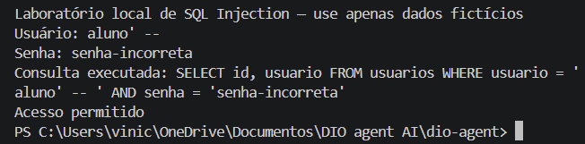
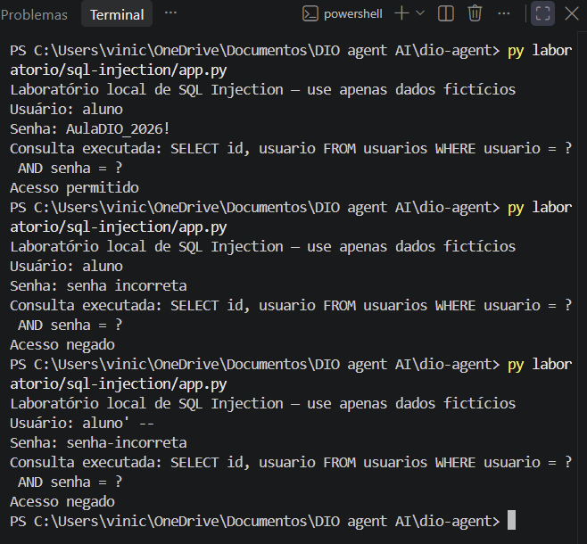

# Security Review Agent

Especialização do [DIO Agent](https://github.com/digitalinnovationone/dio-agent) desenvolvida por Vinícius Botelho para o desafio de cibersegurança da DIO.

O objetivo é fazer o agente entender o cenário antes de recomendar uma ação, explicar a causa de uma falha e acompanhar sua correção. A melhoria escolhida é manter uma ligação explícita entre **evidência, prioridade e reteste** em cada análise.

Não há treinamento de modelo. A especialização é definida em arquivos Markdown que o harness lê. O ambiente escolhido para a execução é Windows com Claude Code no VS Code.

## Situação da entrega

| Parte | Situação |
|---|---|
| Login vulnerável e versão corrigida | Preservados e revisados |
| Evidências do Windows | Login antes/depois, suíte com 12 testes OK e resposta sobre backup |
| Testes do login | 12 verificações aprovadas no ambiente de revisão; saída em `evidencias/resultados-testes.txt` |
| Skill, conhecimento, persona e registro | Implementados |
| Comportamento da skill no Claude Code | Quatro cenários registrados; 1/2 com ressalvas e correção assistida; 3/4 atendem aos objetivos principais; revalidação independente de 1/2 não comprovada |
| Repositório público do autor | [viniBottelho/security-review-agent](https://github.com/viniBottelho/security-review-agent) |

## Especialização

A habilidade `vulnerability-analysis` começa pelas informações disponíveis e pergunta o que falta, uma questão por vez. Depois identifica o achado, avalia impacto e probabilidade, justifica a severidade e a prioridade, orienta a correção e define o reteste. O agente deve distinguir observação de hipótese e deixar como pendente tudo que não foi executado.

O formato permite comparar casos de código e infraestrutura. Os critérios de risco são qualitativos e didáticos; não são uma fórmula oficial nem uma pontuação CVSS inventada.

## Arquivos criados ou alterados

| Arquivo | Função |
|---|---|
| [SKILL.md](skills/vulnerability-analysis/SKILL.md) | Roteiro de análise que o agente segue |
| [README da skill](skills/vulnerability-analysis/README.md) | Explicação da habilidade e de seu acionamento |
| [security-basics.md](agent/knowledge/security-basics.md) | Conceitos, critérios e referências |
| [persona.md](agent/persona.md) | Acrescenta o comportamento de mentor de segurança |
| [AGENTS.md](AGENTS.md) | Registra a skill e a base de conhecimento |
| [Índice de skills](skills/README.md) | Inclui a nova habilidade |
| [test_login.py](laboratorio/sql-injection/test_login.py) | Compara as versões pelo terminal |
| [.gitignore](.gitignore) | Acrescenta exclusões para Python e arquivos de ambiente |

O [CLAUDE.md](CLAUDE.md) original foi mantido e importa `AGENTS.md`. O [README da base](README-base.md) permanece disponível na raiz, preservando seus links relativos. As skills anteriores foram mantidas.

## Como executar

Abrir no VS Code a pasta que contém `AGENTS.md` e `CLAUDE.md`, instalar a extensão oficial Claude Code e entrar com a conta da assinatura. A extensão tem sua própria interface de conversa. Confirmar a leitura dos arquivos atualizados antes de testar a especialização.

Um pedido inicial para testar o comportamento é:

> Tenho um servidor Ubuntu de laboratório exposto à internet e quero revisar a segurança. Por onde começo?

O agente deve investigar o contexto antes de sugerir comandos. O [roteiro de validação](docs/validacao-agente.md) traz os cenários e critérios de avaliação. O [guia para retomar no VS Code](docs/retomar-no-vscode.md) explica como aplicar este pacote e registrar o que falta.

Referência de instalação: [Claude Code no VS Code](https://code.claude.com/docs/en/vs-code). Referência do mecanismo de instruções: [documentação do Claude Code](https://code.claude.com/docs/en/memory).

## Laboratório de SQL Injection

Requisito: Python 3 com o módulo padrão `sqlite3`. Não há dependências externas a instalar. O banco é recriado em memória a cada execução.

Na raiz, usar o terminal PowerShell:

```powershell
py laboratorio/sql-injection/app_vulneravel.py
py laboratorio/sql-injection/app.py
```

Executar um comando por vez e responder às entradas. Conta fictícia: `aluno` / `AulaDIO_2026!`. A análise completa está em [analise-sql-injection.md](docs/analise-sql-injection.md).

| Caso | Versão vulnerável | Versão corrigida |
|---|---|---|
| Credenciais corretas | Permite | Permite |
| Senha incorreta | Nega | Nega |
| Usuário inexistente | Nega | Nega |
| Apóstrofo isolado no usuário | Erro SQLite e negação | Nega sem erro SQL |
| `aluno' -- ` com senha incorreta | Permite indevidamente | Nega |
| `aluno` com senha `' OR '1'='1` | Permite indevidamente | Nega |

Para reproduzir a comparação automaticamente:

```powershell
py laboratorio/sql-injection/test_login.py
```

São seis casos por versão. Os testes da versão vulnerável esperam observar a falha; sua aprovação não significa que essa versão é segura. O [registro de revisão](evidencias/resultados-testes.txt) informa o sistema, a versão do Python e a saída efetiva.

## Evidências do autor

Antes da correção, uma entrada manipulada permitiu o login com senha incorreta:



Depois da correção, o login legítimo continuou funcionando e a mesma entrada foi rejeitada:



## Avaliação do agente

As respostas fornecidas pelo autor mostraram investigação de contexto e identificação da parametrização, mas também afirmações imprecisas. A skill foi revisada para separar severidade de validação, distinguir relato de evidência examinada e evitar garantias sobre backups ou exposição de senhas. A resposta corrigida após orientação não foi contada como aprovação independente. Os cenários adicionais de SSH/firewall e porta aberta/CVSS atenderam aos objetivos principais, conforme as [respostas fornecidas pelo autor](evidencias/respostas-cenarios-3-e-4.md). O [registro de avaliação](docs/avaliacao-comportamento.md) documenta os resultados e seus limites.

A [suíte no Windows](evidencias/03-testes-automatizados.png) também terminou com 12 testes aprovados. O [print sobre backup e acesso](evidencias/05-backup-e-acesso.png) registra a continuação do cenário 1.

## Limites

O exemplo é local e usa apenas dados fictícios. A senha permanece em texto simples e a digitação fica visível no terminal. A mudança corrige a construção da consulta; não entrega um sistema de autenticação pronto para produção. Não há evidência de comprometimento de dados reais ou de um serviço público.

A documentação distingue a classe CWE-89 de uma eventual associação à T1190 em outro cenário. Nenhum CVE foi atribuído ao exemplo. Os testes do agente devem ser registrados separadamente dos testes Python.

## Créditos

Base: [digitalinnovationone/dio-agent](https://github.com/digitalinnovationone/dio-agent). Especialização e laboratório: Vinícius Botelho. As referências técnicas estão em [security-basics.md](agent/knowledge/security-basics.md).
